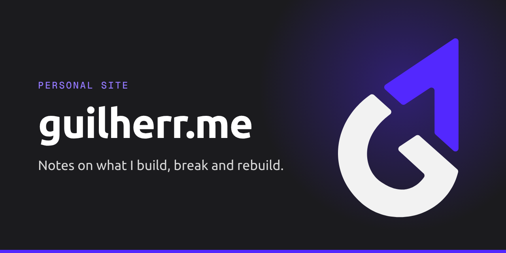

<h1 align="center">guilherr.me</h1>

<p align="center">
  <strong>The personal site of Guilherme Mota: what I build, break and rebuild.</strong>
  <br />
  <em>A home, a blog and a 404, in one dark theme. Static Next.js: posts are Markdown, projects are JSON, and both change through pull requests.</em>
</p>

<p align="center">
  <a href="https://guilherr.me"></a>
  <a href="#development"></a>
  <a href="https://github.com/guilhermebkel/personal-website/actions/workflows/ci.yml"></a>
  <a href="LICENSE"></a>
  
</p>

<p align="center">
  
</p>

---

**You want to see what Guilherme builds and read what he writes, without a login, a cookie wall or a portfolio sales pitch.**

guilherr.me is a one-page home with five sections (intro, projects, posts, quotes, contact), a blog and a 404. It exposes his work; it is not a portfolio storefront. The whole site is a static export: there is no server code at request time, no database and no login.

> **Content is data.** A post or a project that fails its schema fails the build, so a broken page never reaches the site.

---

## What you get

<table>
<tr>
<td width="50%" valign="top">

**A blog in Markdown**

One file per post in `content/posts/`, with front-matter checked by a Zod schema. Posts get an RSS feed and their own Open Graph image.

</td>
<td width="50%" valign="top">

**Projects as files**

One JSON file per project in `content/projects/`: kind, tags, cover and order. The owner chooses what shows, and a pull request changes it.

</td>
</tr>
<tr>
<td valign="top">

**One dark theme, one source of truth**

Every color and size is a token in `design/system/tokens.json`; the Tailwind theme is generated from it. No hex value lives anywhere else.

</td>
<td valign="top">

**Checked like a product**

Accessibility, sideways scroll and console errors are tested on every route at three screen sizes. Link, SEO and size budget checks run on the build.

</td>
</tr>
</table>

## Development

You need the Node version in `.nvmrc` and pnpm.

```bash
nvm use
pnpm ensure-deps
pnpm dev
```

```bash
pnpm check:changed     # before a commit: only what the branch changed
pnpm check             # everything, as CI does: types, lint, dead code, tests, build, e2e
pnpm prototype:shots   # the approved prototype boards as PNGs in test-results/prototype/
pnpm prototype:compare # after pnpm build: each board beside the page it matches
```

An agent or a person starts with [`AGENTS.md`](AGENTS.md): how to work here, which doc to read for each kind of task, and the rules the checks enforce.

## How it works

```text
  content/*.md|json ──▶ 1. SCHEMA ──▶ 2. BUILD ──▶ 3. STATIC FILES ──▶ host
  posts and projects    Zod checks    Next.js       out/: HTML, feed,   serves files,
                        every file    renders       sitemap, OG images  runs nothing
```

| Part                              | Does                                                                                                    | Why                                                                    |
| --------------------------------- | ------------------------------------------------------------------------------------------------------- | ---------------------------------------------------------------------- |
| **Content** (`content/`)          | Posts as Markdown, projects as JSON                                                                     | A change is a reviewed diff, not a form in an admin screen.            |
| **Logic** (`src/`)                | Schemas, services and helpers with no UI, in layers: Protocols < Schemas < Utils < Services < Factories | A lower layer never imports a higher one, and a lint rule enforces it. |
| **Pages** (`app/`, `components/`) | Next.js App Router, static export to `out/`                                                             | The site needs no server, so the host only serves files.               |
| **Design** (`design/`)            | The tokens, the logo and the approved prototype boards                                                  | The prototype is reference only; the site imports nothing from it.     |

The reasons and the trade-offs are in [`docs/adr/`](docs/adr/); the vocabulary in [`GLOSSARY.md`](GLOSSARY.md). The harness (checks, docs and rules) follows the one of `tocomevidencia`.

### Repository layout

| Path         | What it is                                           |
| ------------ | ---------------------------------------------------- |
| `app`        | Routes, pages and layouts                            |
| `components` | UI components, with shadcn/ui behind an intermediate |
| `content`    | `posts/` (Markdown) and `projects/` (JSON)           |
| `src`        | Logic with no UI                                     |
| `design`     | Logo, design system tokens and the prototype boards  |
| `e2e`        | Playwright tests on the build                        |
| `scripts`    | Harness scripts and their tests                      |
| `docs`       | Standards, guides and decisions (ADRs)               |

Stack: Next.js (App Router, static export), TypeScript, Tailwind v4 and shadcn/ui, Zod, Vitest and Playwright.

## Writing a post

Add `content/posts/<slug>.md` with front-matter and open a pull request; the format is in [`docs/content.md`](docs/content.md). Posts written by the AI arrive as pull requests and only Guilherme merges them.

## Privacy

- **No accounts and no forms.** The site asks nothing from a visitor.
- **Measurement.** Google Tag Manager is loaded from the site's own static host ([ADR 0007](docs/adr/0007-google-tag-manager-from-the-static-host.md)).

## FAQ

<details>
<summary><b>Can I reuse the code?</b></summary>

Yes, under the MIT license. The posts, the logo and the cover images are Guilherme's own and are not covered by it.

</details>

<details>
<summary><b>How does a project get on the site?</b></summary>

A pull request adds a file to `content/projects/` (and a cover under `public/covers/`). The fields and the checks are in [`docs/content.md`](docs/content.md).

</details>

## Contributing

This is a personal site, so the content is not open for contributions, but a bug or a typo is welcome as an issue or a pull request. Start with [`AGENTS.md`](AGENTS.md); every change goes through a pull request that closes one issue.

```bash
pnpm install
pnpm check   # types, lint, dead code, duplication, tests, build and e2e
```

---

<p align="center">
  <strong>Notes on what I build, break and rebuild.</strong>
</p>

<p align="center">
  MIT License &copy; Guilherme Mota
</p>
